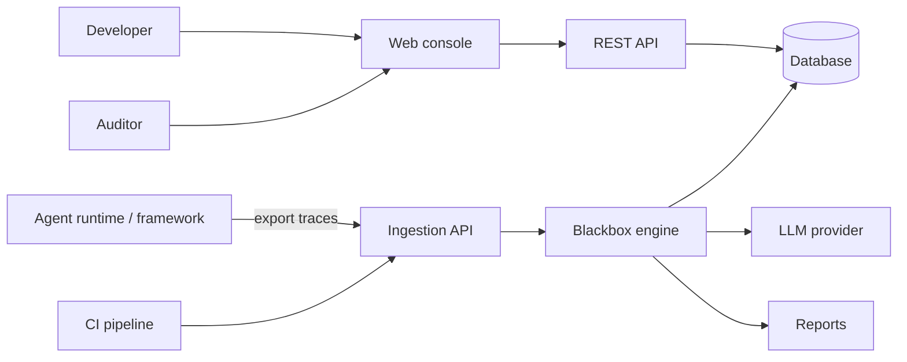

# 02. Software Requirements Specification (SRS)

## 1. Purpose and scope

This SRS defines what **Blackbox for Agents** must do. It follows BABOK-style practice: requirements are testable, traceable, and prioritized (MoSCoW).

## 2. System context



## 3. Definitions

See doc 15. Key terms: **Flight Record** (normalized run), **Rulebook**, **Check**, **Guard**, **Evidence Ledger**, **Point of No Return (PNR)**, **Adjudicator**, **Verdict**.

## 4. Functional requirements

Priority: **M** Must, **S** Should, **C** Could, **W** Won't (this release).

### 4.1 Ingestion and normalization

| ID | Requirement | Pri |
|---|---|---|
| FR-001 | The system shall accept a trace upload as JSON or JSONL via UI and API. | M |
| FR-002 | The system shall normalize every accepted trace into the Flight Record schema (doc 04). | M |
| FR-003 | The system shall reject malformed traces with a precise, field-level error. | M |
| FR-004 | The system shall support adapters: Generic JSONL (MVP), OpenTelemetry spans (v0.5), at least two agent frameworks (v0.5). | M/S |
| FR-005 | The system shall store the raw upload unchanged with a SHA-256 hash for integrity. | M |
| FR-006 | The system shall redact configured sensitive patterns (emails, keys, IDs) before storage and before any model call. | M |
| FR-007 | The system shall allow attaching tool schemas and policy documents to a project. | M |

### 4.2 Rulebooks and checks

| ID | Requirement | Pri |
|---|---|---|
| FR-010 | The system shall load Rulebooks written in YAML (spec in doc 05). | M |
| FR-011 | Each Check shall have an id, guard, assertion, severity, taxonomy code, and message template. | M |
| FR-012 | The system shall auto-derive baseline Checks from tool schemas (argument validity, required fields, output shape). | M |
| FR-013 | The system shall support policy Checks written by users (for example, confirmation before deletion). | M |
| FR-014 | The system shall version Rulebooks and record which version produced each verdict. | M |
| FR-015 | The system shall provide a Rulebook validator (lint) that reports errors before activation. | S |
| FR-016 | The system shall support suggested Check drafts generated by the language model, always requiring human approval before activation. | C |

### 4.3 Analysis engine

| ID | Requirement | Pri |
|---|---|---|
| FR-020 | The system shall evaluate applicable Checks step by step in trace order. | M |
| FR-021 | A Check shall run only when its guard evaluates true for the step. | M |
| FR-022 | Every violation shall be written to the Evidence Ledger with step, check, observed value, expected condition, and excerpt. | M |
| FR-023 | The system shall compute the Point of No Return using the recoverability model (doc 05). | M |
| FR-024 | The system shall call the Adjudicator with the Evidence Ledger and taxonomy to confirm the PNR and root-cause category. | M |
| FR-025 | The Adjudicator output shall conform to a strict JSON schema; invalid output shall be retried then flagged. | M |
| FR-026 | When no deterministic violation exists, the system shall return a "model-only" verdict clearly labeled lower confidence. | M |
| FR-027 | The system shall be deterministic for the rule stage: same trace and rulebook yield the same ledger. | M |
| FR-028 | The system shall support multi-agent traces, including handoff steps between agents. | S |
| FR-029 | The system shall detect loops and stalls (repeated near-identical actions). | S |

### 4.4 Investigation console (UI)

| ID | Requirement | Pri |
|---|---|---|
| FR-030 | The UI shall show a step timeline with violations marked and the PNR highlighted. | M |
| FR-031 | The UI shall show, per step, the raw content, normalized fields, and linked evidence. | M |
| FR-032 | The UI shall show verdict, category, confidence, and reasoning summary. | M |
| FR-033 | The UI shall allow reviewers to accept, correct, or reject a verdict and add notes. | M |
| FR-034 | The UI shall filter investigations by project, agent, date, category, status. | S |
| FR-035 | The UI shall compare two runs side by side. | C |

### 4.5 Reporting and export

| ID | Requirement | Pri |
|---|---|---|
| FR-040 | The system shall export an investigation report as Markdown and JSON. | M |
| FR-041 | The system shall export a PDF report. | S |
| FR-042 | Reports shall include rulebook version, trace hash, model name and version, and timestamps. | M |
| FR-043 | The system shall support a signed report (hash chain or digital signature). | C |

### 4.6 Administration

| ID | Requirement | Pri |
|---|---|---|
| FR-050 | The system shall support users, roles (Admin, Analyst, Viewer), and projects. | M |
| FR-051 | The system shall record an audit log of administrative and review actions. | M |
| FR-052 | The system shall support API keys per project. | M |
| FR-053 | The system shall support SSO (OIDC). | S |
| FR-054 | The system shall support data retention policies per project. | S |

### 4.7 Evaluation (accuracy benchmark)

| ID | Requirement | Pri |
|---|---|---|
| FR-060 | The system shall run a labeled benchmark set and report PNR accuracy and category agreement. | M |
| FR-061 | Reviewer corrections shall be exportable as labeled data for the benchmark. | S |
| FR-062 | The system shall compare rulebook versions on the same benchmark. | S |

## 5. Non-functional requirements

| ID | Category | Requirement |
|---|---|---|
| NFR-001 | Performance | Rule stage completes in under 5 s for a 200-step trace. |
| NFR-002 | Performance | End-to-end verdict under 60 s (p95) for 100 steps, excluding queue wait. |
| NFR-003 | Scalability | Process at least 20 concurrent investigations per worker pool on the MVP server. |
| NFR-004 | Availability | 99.5% monthly for pilot. |
| NFR-005 | Security | All data encrypted in transit (TLS 1.2+) and at rest. |
| NFR-006 | Security | RBAC enforced on every endpoint; project-level isolation. |
| NFR-007 | Privacy | Redaction applied before storage and before model calls; configurable. |
| NFR-008 | Auditability | All verdicts reproducible from stored inputs and versions. |
| NFR-009 | Usability | New user completes first investigation within 10 minutes using the guided sample. |
| NFR-010 | Accessibility | UI meets WCAG 2.1 AA. |
| NFR-011 | Maintainability | Core engine has at least 85% unit test coverage; modules documented. |
| NFR-012 | Portability | Runs via Docker Compose on Linux; no cloud lock-in. |
| NFR-013 | Observability | Structured logs, metrics, and traces for the platform itself. |
| NFR-014 | Compatibility | Ingest traces up to 50 MB; steps up to 5,000 per trace (configurable). |
| NFR-015 | Extensibility | Adapters and checks pluggable without changing core. |
| NFR-016 | Model portability | LLM provider abstracted behind an interface; swap by configuration. |

## 6. User stories with acceptance criteria

### US-001 Upload a failed run
*As a developer, I want to upload a failed agent run so that I can get a diagnosis.*

```gherkin
Scenario: Valid trace upload
  Given I am signed in to project "support-bot"
  When I upload a valid JSONL trace
  Then the system stores the raw file with a SHA-256 hash
  And creates a Flight Record with a step count
  And queues an investigation

Scenario: Malformed trace
  Given I upload a trace with a missing "role" on step 4
  Then I see an error naming step 4 and the field "role"
  And no investigation is created
```

### US-002 See where it broke
*As a developer, I want the Point of No Return highlighted so that I stop reading logs.*

```gherkin
Scenario: PNR found by rules
  Given a trace where step 7 calls "delete_order" without prior confirmation
  And the rulebook has check "POL-CONFIRM-DELETE"
  When the investigation completes
  Then step 7 is marked as the Point of No Return
  And the evidence panel shows check "POL-CONFIRM-DELETE" with the step excerpt
```

### US-003 Trust the verdict
*As an auditor, I want evidence behind every verdict so that I can defend it.*

```gherkin
Scenario: Evidence completeness
  Given a completed investigation
  Then each cited violation links to step, check id, observed value, and expected condition
  And the report states rulebook version, trace hash, and model version
```

### US-004 Author a policy check
*As a compliance lead, I want to write a policy check in YAML so that it applies to all agents.*

```gherkin
Scenario: Lint before activation
  Given I submit a rulebook with an unknown field "sev"
  When I run validation
  Then I get an error naming the field and line
  And the rulebook cannot be activated
```

### US-005 Review and correct
*As an analyst, I want to correct a wrong verdict so that the benchmark improves.*

```gherkin
Scenario: Correction stored
  Given a verdict names step 9
  When I change the PNR to step 6 and add a note
  Then the correction is saved with my user id and timestamp
  And it is available in the labeled-data export
```

### US-006 Export a report
*As an auditor, I want a report I can file as audit evidence.*

```gherkin
Scenario: Markdown report
  When I click Export > Markdown
  Then I receive a file with summary, timeline, evidence ledger, verdict, and integrity metadata
```

### US-007 Sensitive data protection
*As a platform engineer, I want secrets redacted so that traces do not leak data.*

```gherkin
Scenario: Redaction
  Given redaction rules for API keys and emails
  When a trace containing "sk-..." and "a@b.com" is uploaded
  Then stored content and model prompts contain placeholders instead
```

### US-008 Measure accuracy
*As a product owner, I want a benchmark score so that I know if a rulebook change helped.*

```gherkin
Scenario: Compare versions
  Given a labeled benchmark of 50 traces
  When I run rulebook v1.2 and v1.3
  Then I see PNR accuracy and category agreement for each, and the delta
```

### US-009 Run from CI
*As a platform engineer, I want to call the API from CI so that failed runs are analyzed automatically.*

```gherkin
Scenario: API key ingestion
  Given a project API key
  When my pipeline POSTs a trace to /v1/records
  Then I receive 202 with an investigation id
  And I can poll /v1/investigations/{id} until status is "completed"
```

### US-010 Multi-agent handoff
*As a developer, I want handoff errors flagged so that I see which agent corrupted the context.*

```gherkin
Scenario: Handoff corruption
  Given agent A passes a summary missing a required field to agent B
  Then a check of type "handoff" flags the handoff step
  And the category is "Handoff Corruption"
```

## 7. Use cases (summary)

| UC | Name | Primary actor | Main flow |
|---|---|---|---|
| UC-01 | Investigate failed run | Developer | Upload, wait, review timeline, read verdict, export |
| UC-02 | Maintain rulebook | Compliance lead | Edit, lint, test on benchmark, activate |
| UC-03 | Audit review | Auditor | Open investigation, verify evidence, accept verdict, export |
| UC-04 | Automated analysis | CI pipeline | POST trace, poll, fail build on critical violations |
| UC-05 | Measure accuracy | Product owner | Run benchmark, compare versions |

## 8. Traceability matrix (excerpt)

| Story | Requirements | Design docs | Test type |
|---|---|---|---|
| US-001 | FR-001..005 | 03, 04 | API + integration |
| US-002 | FR-020..024, FR-030 | 05, 06 | Engine unit + E2E |
| US-003 | FR-022, FR-042 | 04, 05 | Contract + report snapshot |
| US-004 | FR-010..015 | 05 | Lint unit tests |
| US-005 | FR-033, FR-061 | 06, 04 | UI + API |
| US-006 | FR-040..043 | 04, 06 | Snapshot |
| US-007 | FR-006, NFR-007 | 07 | Security unit + integration |
| US-008 | FR-060..062 | 05, 08 | Benchmark |
| US-009 | FR-052, NFR-003 | 04, 09 | API + load |
| US-010 | FR-028 | 05 | Engine unit |

## 9. Definition of Ready (DoR)

- Story has persona, value, acceptance criteria in Gherkin.
- Dependencies identified; estimate agreed.
- Design notes linked.
- Test approach noted.

## 10. Definition of Done (DoD)

- Code reviewed and merged; CI green.
- Unit and integration tests added; coverage gate met.
- Acceptance criteria demonstrated.
- Security checks passed (lint, dependency scan, secrets scan).
- Docs updated (this doc set where relevant).
- Deployed to staging; no new high-severity defects.

## 11. Open questions

| # | Question | Owner | Due |
|---|---|---|---|
| Q1 | Which agent frameworks first for adapters? | Product | Sprint 3 |
| Q2 | Preferred LLM provider and data residency for pilots? | Founder | Sprint 1 |
| Q3 | Is a human-labeled benchmark available internally, or do we label our own? | Product + Audit | Sprint 2 |
| Q4 | Retention defaults for trace data? | Legal | Sprint 4 |

## Change log

| Version | Date | Change |
|---|---|---|
| 1.0.0 | 2026-10-24 | Initial version |
