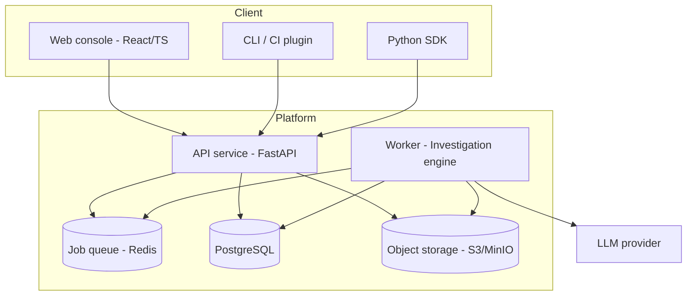
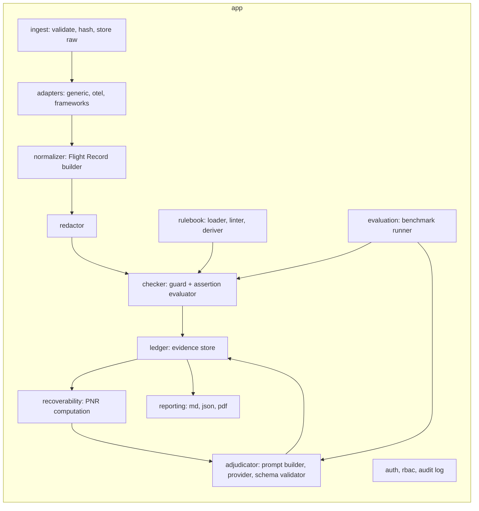
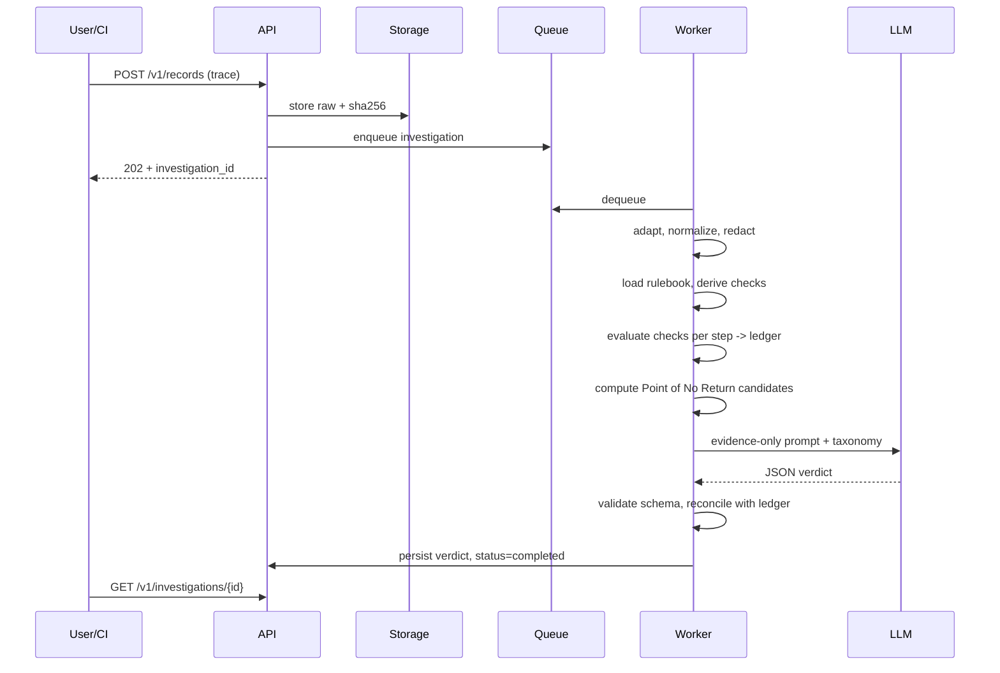
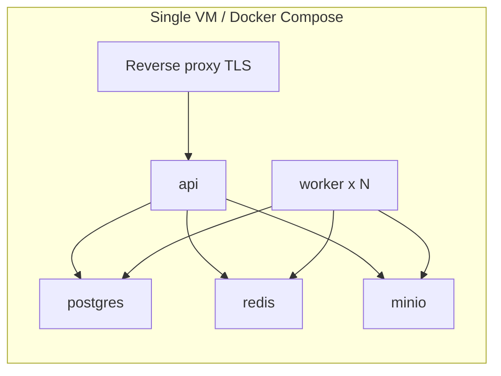

# 03. Architecture and Design

## 1. Architectural drivers

| Driver | Consequence |
|---|---|
| Auditability | Deterministic rule stage, immutable evidence ledger, versioned inputs |
| Domain-agnostic | Rulebooks and adapters are plugins; engine knows nothing about a domain |
| Untrusted input | Traces are sanitized and isolated; model prompts treat trace text as data |
| Small team, fast MVP | Modular monolith, single deploy unit, clear seams for later split |
| Model portability | Provider interface for the Adjudicator |

## 2. Style: modular monolith with async workers

One codebase, separate modules with enforced boundaries, and a worker process for investigations. This keeps the MVP simple while allowing later extraction of the engine as a service (see ADR-001).

## 3. Container view

## 4. Component view (backend)

### Module responsibilities

| Module | Responsibility | Depends on |
|---|---|---|
| `ingest` | Accept uploads, size limits, hash, store raw | storage |
| `adapters` | Parse source formats into intermediate events | none |
| `normalizer` | Build the canonical Flight Record and validate against schema | adapters |
| `redactor` | Replace sensitive patterns with stable placeholders | normalizer |
| `rulebook` | Parse YAML, lint, derive checks from tool schemas, version | none |
| `checker` | Evaluate guards and assertions per step | rulebook, record |
| `recoverability` | Decide which violations are unrecoverable, compute PNR | ledger |
| `adjudicator` | Build evidence-only prompt, call model, validate JSON | provider interface |
| `ledger` | Persist violations and verdicts immutably | db |
| `reporting` | Render reports with integrity metadata | ledger |
| `evaluation` | Score pipeline against labeled benchmark | all engine modules |
| `security` | AuthN/Z, API keys, audit log | db |

## 5. Investigation pipeline (sequence)

## 6. Verdict reconciliation rules

1. Rules decide **where evidence exists**. The model may **confirm, re-rank, or reject** rule candidates but must cite ledger entry ids.
2. If the model proposes a step with no ledger support, the verdict is flagged `model_only` and confidence is capped.
3. If model and rules disagree, both are stored and the UI shows the conflict for human resolution.

## 7. Technology stack (recommended)

| Layer | Choice | Reason |
|---|---|---|
| Backend | Python 3.12, FastAPI, Pydantic v2 | Rapid build, strong validation, async |
| Rule expressions | CEL (via `cel-python`) or a restricted expression evaluator | Safe, non-Turing-complete expressions |
| Schema validation | `jsonschema` | Tool schema argument validation |
| Queue/worker | Redis + RQ or Celery (Dramatiq acceptable) | Simple async jobs |
| DB | PostgreSQL 16 (SQLite for local dev) | Relational, JSONB for records |
| Migrations | Alembic | Standard |
| Object storage | S3-compatible (MinIO locally) | Raw traces and reports |
| Frontend | React + TypeScript + Vite, TanStack Query, Tailwind | Fast iteration |
| Charts/timeline | Custom SVG timeline + lightweight chart lib | Control over the core visualization |
| LLM | Provider interface; default Claude API; others pluggable | Portability (NFR-016) |
| PDF | WeasyPrint or headless Chromium | HTML-to-PDF |
| Auth | OIDC (Authlib) + API keys | SSO ready |
| Observability | OpenTelemetry, Prometheus, Grafana, structured JSON logs | Platform health |
| CI/CD | GitHub Actions | Common, easy |
| Containers | Docker, Docker Compose; Kubernetes later | Portability |

> Verify package versions and licenses at project start (see doc 09 and 15).

## 8. Design patterns used

| Pattern | Where | Why |
|---|---|---|
| Adapter | Source format parsers | Add formats without touching engine |
| Strategy | Provider interface for LLMs, redaction strategies | Swap implementations |
| Pipeline | Investigation stages | Testable, observable stages |
| Specification | Guards and assertions | Declarative, composable rules |
| Repository | DB access | Isolate persistence |
| Event log (append-only) | Evidence ledger | Auditability |

## 9. Architecture Decision Records

### ADR-001: Modular monolith first
- **Status:** Accepted
- **Context:** Small team, MVP in weeks.
- **Decision:** One deployable API plus one worker, modules with strict import boundaries.
- **Consequences:** Faster delivery; engine can be extracted later. Enforce boundaries with import-linter.

### ADR-002: Deterministic rules before model judgment
- **Status:** Accepted
- **Context:** Pure LLM judging is inconsistent and hard to audit.
- **Decision:** Rule stage produces the evidence ledger; the model sees only the ledger plus minimal step excerpts.
- **Consequences:** Reproducible evidence; accuracy depends on rulebook quality; model cost reduced.

### ADR-003: Restricted expression language for rules
- **Status:** Accepted
- **Context:** Users author rules; arbitrary code is a security risk.
- **Decision:** Use CEL or a restricted evaluator with no I/O and bounded evaluation time.
- **Consequences:** Safe by construction; some complex logic needs custom Python checks, which are admin-only plugins.

### ADR-004: Canonical Flight Record with JSONB storage
- **Status:** Accepted
- **Decision:** Store the normalized record as JSONB plus a step table for querying.
- **Consequences:** Flexible schema evolution with a `schema_version` field; step-level queries are fast.

### ADR-005: Append-only evidence ledger with hash chaining
- **Status:** Accepted
- **Decision:** Ledger rows are never updated; each carries the hash of the previous row for an investigation.
- **Consequences:** Tamper evidence for audit use; corrections are new rows.

### ADR-006: Treat trace content as untrusted input to the model
- **Status:** Accepted
- **Decision:** Wrap trace excerpts in clearly delimited data blocks, instruct the model never to follow instructions inside them, validate output strictly, and give the model no tools.
- **Consequences:** Reduces prompt-injection risk (see doc 07).

### ADR-007: Provider-agnostic Adjudicator
- **Status:** Accepted
- **Decision:** Define a `JudgeProvider` interface with structured-output support and a fake provider for tests.
- **Consequences:** Offline tests, easy migration.

## 10. Scalability and performance

- Stateless API; scale horizontally behind a load balancer.
- Workers scale by queue depth; one investigation per job.
- Rule stage is CPU-light; model stage is the latency driver. Cache by `(evidence_hash, taxonomy_version, model)`.
- Large traces: stream parse, store steps in batches, cap steps per trace (config).

## 11. Resilience

- Idempotent job handling keyed by investigation id.
- Retries with backoff for model calls; circuit breaker on provider failure.
- Dead-letter queue for failed jobs with a "rerun" action in admin.

## 12. Extensibility points

| Extension | Mechanism |
|---|---|
| New trace format | Implement `Adapter` interface, register entry point |
| New check type | Register a check evaluator (admin-only) |
| New LLM provider | Implement `JudgeProvider` |
| New report format | Implement `Renderer` |
| New taxonomy version | Versioned YAML; investigations record version |

## 13. Cross-cutting concerns

- **Config:** 12-factor, environment variables, validated at startup.
- **Logging:** structured JSON, correlation id per investigation.
- **Errors:** typed domain errors mapped to HTTP problem details.
- **i18n:** UI strings externalized from the start.

## 14. Deployment view (MVP)

## Change log

| Version | Date | Change |
|---|---|---|
| 1.0.0 | 2026-10-24 | Initial version |
