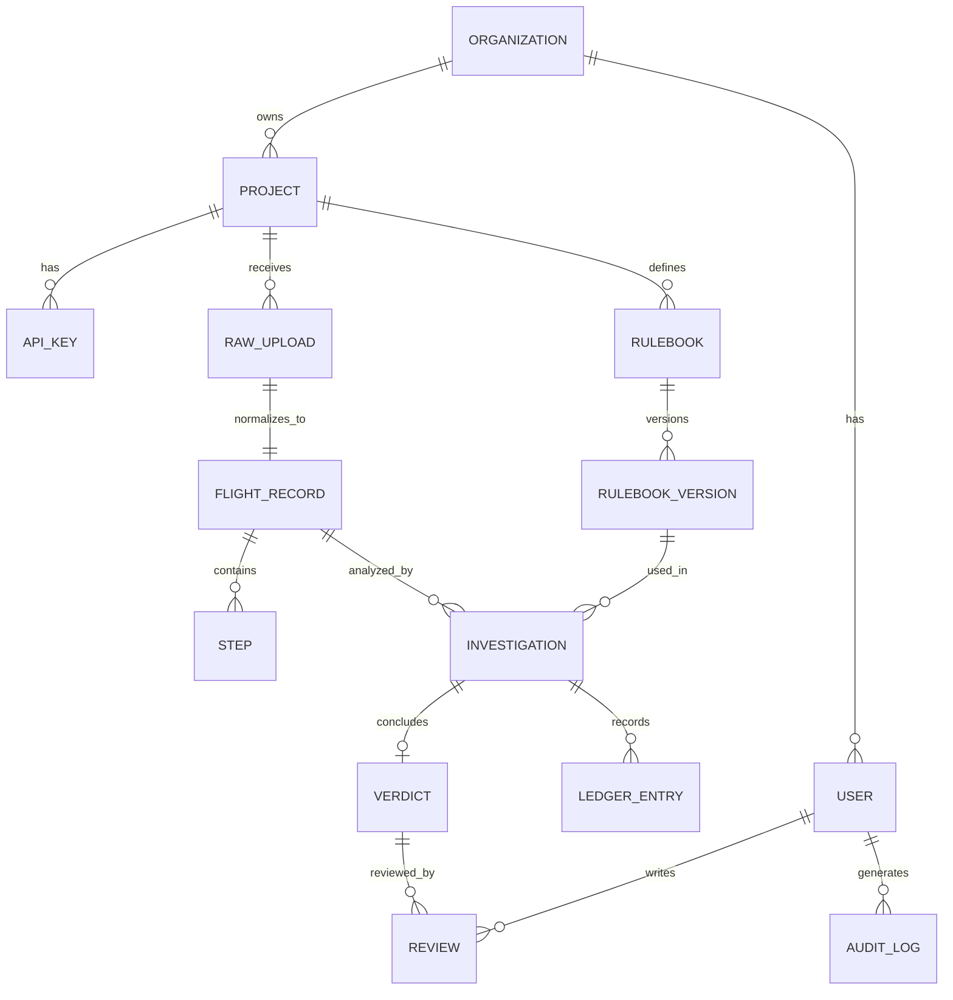

# 04. Data Model and API

## 1. Flight Record (canonical schema)

The **Flight Record** is the normalized, source-independent representation of one agent run. It is the contract between adapters and the engine.

### 1.1 Concept

```
FlightRecord
 ├─ record_id, schema_version, source_format, created_at
 ├─ task          (goal text, constraints, user_context)
 ├─ agents[]      (agent_id, role, model_hint)
 ├─ tools[]       (name, description, input_schema, output_schema)
 ├─ policies[]    (policy_id, text, version)
 └─ steps[]       (ordered events)
      ├─ index (0-based, unique, monotonic)
      ├─ actor (agent_id | "user" | "tool" | "system")
      ├─ kind  (message | tool_call | tool_result | handoff | decision | system_event)
      ├─ content (text) and/or structured payload
      ├─ tool_call   { tool, arguments }            (kind = tool_call)
      ├─ tool_result { tool, output, error }        (kind = tool_result)
      ├─ handoff     { from, to, payload }          (kind = handoff)
      ├─ ts (optional ISO-8601)
      └─ meta (free-form, namespaced)
```

### 1.2 JSON Schema (draft 2020-12, abridged)

```json
{
  "$schema": "https://json-schema.org/draft/2020-12/schema",
  "$id": "https://blackbox.example/schemas/flight-record-1.json",
  "title": "FlightRecord",
  "type": "object",
  "required": ["record_id", "schema_version", "task", "steps"],
  "properties": {
    "record_id": { "type": "string" },
    "schema_version": { "const": "1" },
    "source_format": { "type": "string" },
    "task": {
      "type": "object",
      "required": ["goal"],
      "properties": {
        "goal": { "type": "string" },
        "constraints": { "type": "array", "items": { "type": "string" } }
      }
    },
    "agents": { "type": "array", "items": { "$ref": "#/$defs/agent" } },
    "tools": { "type": "array", "items": { "$ref": "#/$defs/tool" } },
    "policies": { "type": "array", "items": { "$ref": "#/$defs/policy" } },
    "steps": { "type": "array", "minItems": 1, "items": { "$ref": "#/$defs/step" } }
  },
  "$defs": {
    "agent":  { "type": "object", "required": ["agent_id"], "properties": { "agent_id": {"type":"string"}, "role": {"type":"string"} } },
    "tool":   { "type": "object", "required": ["name"], "properties": { "name": {"type":"string"}, "input_schema": {"type":"object"}, "output_schema": {"type":"object"} } },
    "policy": { "type": "object", "required": ["policy_id","text"], "properties": { "policy_id": {"type":"string"}, "text": {"type":"string"} } },
    "step": {
      "type": "object",
      "required": ["index", "actor", "kind"],
      "properties": {
        "index": { "type": "integer", "minimum": 0 },
        "actor": { "type": "string" },
        "kind": { "enum": ["message","tool_call","tool_result","handoff","decision","system_event"] },
        "content": { "type": "string" },
        "tool_call": { "type": "object", "required": ["tool"], "properties": { "tool": {"type":"string"}, "arguments": {"type":"object"} } },
        "tool_result": { "type": "object", "required": ["tool"], "properties": { "tool": {"type":"string"}, "output": {}, "error": {"type":["string","null"]} } },
        "handoff": { "type": "object", "required": ["from","to"], "properties": { "from": {"type":"string"}, "to": {"type":"string"}, "payload": {} } },
        "ts": { "type": "string", "format": "date-time" },
        "meta": { "type": "object" }
      }
    }
  }
}
```

### 1.3 Minimal example (JSONL source, one event per line)

```json
{"index":0,"actor":"user","kind":"message","content":"Cancel order 1042 and refund me."}
{"index":1,"actor":"agent-1","kind":"tool_call","tool_call":{"tool":"get_order","arguments":{"order_id":"1042"}}}
{"index":2,"actor":"tool","kind":"tool_result","tool_result":{"tool":"get_order","output":{"status":"shipped"},"error":null}}
{"index":3,"actor":"agent-1","kind":"tool_call","tool_call":{"tool":"cancel_order","arguments":{"order_id":"1042"}}}
```

Here step 3 cancels a shipped order. A policy check can flag it as the Point of No Return.

## 2. Relational data model



### 2.1 Core tables (PostgreSQL DDL, abridged)

```sql
create table organization (id uuid primary key, name text not null, created_at timestamptz default now());

create table project (
  id uuid primary key, org_id uuid references organization(id),
  name text not null, retention_days int default 90, redaction_profile jsonb default '{}'::jsonb,
  created_at timestamptz default now()
);

create table app_user (
  id uuid primary key, org_id uuid references organization(id),
  email text unique not null, role text check (role in ('admin','analyst','viewer')) not null,
  created_at timestamptz default now()
);

create table api_key (
  id uuid primary key, project_id uuid references project(id),
  key_hash text not null, label text, last_used_at timestamptz, revoked_at timestamptz,
  created_at timestamptz default now()
);

create table raw_upload (
  id uuid primary key, project_id uuid references project(id),
  storage_uri text not null, sha256 char(64) not null, size_bytes bigint, source_format text,
  uploaded_by uuid references app_user(id), created_at timestamptz default now()
);

create table flight_record (
  id uuid primary key, raw_upload_id uuid unique references raw_upload(id),
  project_id uuid references project(id), schema_version text not null,
  step_count int not null, record jsonb not null, created_at timestamptz default now()
);

create table step (
  record_id uuid references flight_record(id), idx int not null,
  actor text not null, kind text not null, tool text, summary text,
  primary key (record_id, idx)
);

create table rulebook (id uuid primary key, project_id uuid references project(id), name text not null);

create table rulebook_version (
  id uuid primary key, rulebook_id uuid references rulebook(id),
  version text not null, yaml text not null, checksum char(64) not null,
  status text check (status in ('draft','active','retired')) not null,
  created_by uuid references app_user(id), created_at timestamptz default now(),
  unique (rulebook_id, version)
);

create table investigation (
  id uuid primary key, record_id uuid references flight_record(id),
  rulebook_version_id uuid references rulebook_version(id),
  taxonomy_version text not null, judge_model text,
  status text check (status in ('queued','running','completed','failed')) not null,
  started_at timestamptz, finished_at timestamptz, error text,
  created_at timestamptz default now()
);

create table ledger_entry (
  id bigserial primary key, investigation_id uuid references investigation(id),
  seq int not null, step_idx int, check_id text not null, severity text not null,
  taxonomy_code text, observed jsonb, expected text, excerpt text, message text,
  prev_hash char(64), entry_hash char(64) not null,
  created_at timestamptz default now(), unique (investigation_id, seq)
);

create table verdict (
  id uuid primary key, investigation_id uuid unique references investigation(id),
  pnr_step int, taxonomy_code text, confidence numeric(3,2),
  basis text check (basis in ('rules','rules+model','model_only')) not null,
  cited_ledger_ids bigint[], reasoning text, conflicts jsonb,
  raw_model_output jsonb, created_at timestamptz default now()
);

create table review (
  id uuid primary key, verdict_id uuid references verdict(id), reviewer_id uuid references app_user(id),
  decision text check (decision in ('accept','correct','reject')) not null,
  corrected_pnr_step int, corrected_taxonomy_code text, note text, created_at timestamptz default now()
);

create table audit_log (
  id bigserial primary key, actor_id uuid, action text not null, target_type text, target_id text,
  detail jsonb, created_at timestamptz default now()
);
```

### 2.2 Data rules

- `ledger_entry` and `audit_log` are **append-only** (enforce with DB permissions and triggers).
- `entry_hash = sha256(prev_hash || canonical_json(entry_fields))`.
- Deleting a project cascades to its data only through the retention job, which writes an audit log entry.

## 3. REST API (v1)

Base path: `/v1`. JSON in and out. Auth: `Authorization: Bearer <api_key>` for machines, session or OIDC token for the UI. Errors follow RFC 9457 problem details.

### 3.1 Endpoints

| Method | Path | Purpose | Roles |
|---|---|---|---|
| POST | `/v1/records` | Upload a trace (multipart or JSON body). Returns 202 + investigation id | analyst, api key |
| GET | `/v1/records/{id}` | Fetch the Flight Record | viewer+ |
| GET | `/v1/records/{id}/steps` | Paginated steps | viewer+ |
| GET | `/v1/investigations` | List, filter, paginate | viewer+ |
| GET | `/v1/investigations/{id}` | Status, verdict, summary | viewer+ |
| GET | `/v1/investigations/{id}/ledger` | Evidence ledger entries | viewer+ |
| POST | `/v1/investigations/{id}/rerun` | Rerun with chosen rulebook version | analyst |
| POST | `/v1/verdicts/{id}/reviews` | Accept / correct / reject | analyst |
| GET | `/v1/investigations/{id}/report?format=md\|json\|pdf` | Export report | viewer+ |
| POST | `/v1/rulebooks` | Create rulebook | admin |
| POST | `/v1/rulebooks/{id}/versions` | Upload new version (draft) | admin |
| POST | `/v1/rulebooks/validate` | Lint YAML, return findings | analyst |
| POST | `/v1/rulebooks/{id}/versions/{v}/activate` | Activate version | admin |
| POST | `/v1/benchmarks/runs` | Run benchmark on a rulebook version | analyst |
| GET | `/v1/benchmarks/runs/{id}` | Benchmark result | viewer+ |
| GET | `/v1/export/labels` | Reviewer corrections as labeled data | analyst |
| GET/POST | `/v1/projects`, `/v1/api-keys` | Admin | admin |
| GET | `/healthz`, `/readyz`, `/metrics` | Ops | internal |

### 3.2 Example: upload

```http
POST /v1/records HTTP/1.1
Authorization: Bearer bb_live_xxx
Content-Type: application/json

{
  "project_id": "7c1e...",
  "source_format": "generic-jsonl",
  "rulebook_version_id": null,
  "trace": { "task": {"goal": "Cancel order 1042"}, "steps": [ ... ] }
}
```

```http
HTTP/1.1 202 Accepted
Location: /v1/investigations/9a2f...

{ "investigation_id": "9a2f...", "record_id": "b310...", "status": "queued" }
```

### 3.3 Example: investigation result

```json
{
  "id": "9a2f...",
  "status": "completed",
  "rulebook": { "name": "retail-core", "version": "1.2.0" },
  "taxonomy_version": "1.0",
  "verdict": {
    "pnr_step": 3,
    "taxonomy_code": "BB-POL",
    "basis": "rules+model",
    "confidence": 0.86,
    "cited_ledger_ids": [101, 102],
    "reasoning": "The agent cancelled an order whose status was 'shipped', which policy RET-04 forbids."
  },
  "integrity": { "trace_sha256": "ab12...", "ledger_head": "ff90..." }
}
```

### 3.4 Conventions

- **Pagination:** `?limit=50&cursor=...`, response includes `next_cursor`.
- **Idempotency:** `Idempotency-Key` header on POST uploads.
- **Rate limits:** per API key, `429` with `Retry-After`.
- **Versioning:** URL major version; additive changes only within `v1`.
- **Problem details example:**

```json
{
  "type": "https://blackbox.example/problems/invalid-trace",
  "title": "Trace failed validation",
  "status": 422,
  "errors": [ { "path": "steps[3].actor", "message": "required" } ]
}
```

### 3.5 Webhooks (v1.0)

`investigation.completed` with HMAC-SHA256 signature header; retry with exponential backoff.

## 4. SDK and CLI (planned)

```bash
blackbox login --key $BLACKBOX_KEY
blackbox analyze ./run.jsonl --project support-bot --fail-on critical
blackbox rulebook lint ./rulebooks/retail.yaml
blackbox benchmark run --rulebook retail@1.2.0 --set ./bench/
```

## 5. Storage layout (object storage)

```
raw/{project_id}/{sha256}.jsonl
reports/{investigation_id}/{timestamp}.{md|json|pdf}
bench/{project_id}/{set_id}/...
```

## Change log

| Version | Date | Change |
|---|---|---|
| 1.0.0 | 2026-10-24 | Initial version |
