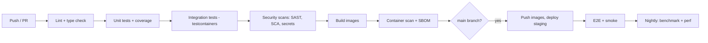

# 09. DevOps and Deployment

## 1. Environments

| Env | Purpose | Data | Deploy trigger |
|---|---|---|---|
| local | Developer machine | Seed/demo | Manual (`make up`) |
| ci | Automated tests | Ephemeral | Every push/PR |
| staging | Integration, UAT, demos | Synthetic + consented pilot data | Merge to `main` |
| production | Pilots and customers | Real | Tagged release, manual approval |

## 2. Repository and branching

- Monorepo: `backend/`, `frontend/`, `taxonomy/`, `rulebooks/`, `docs/`, `deploy/`, `tests/`.
- Trunk-based development with short-lived feature branches; PRs require review and green CI.
- Conventional Commits (`feat:`, `fix:`, `docs:`...) to drive changelog and semantic versioning.
- Protect `main`; no direct pushes.

## 3. CI pipeline (GitHub Actions)



Example workflow skeleton:

```yaml
name: ci
on: [push, pull_request]
jobs:
  backend:
    runs-on: ubuntu-latest
    services:
      postgres:
        image: postgres:16
        env: { POSTGRES_PASSWORD: test }
        ports: ["5432:5432"]
      redis:
        image: redis:7
        ports: ["6379:6379"]
    steps:
      - uses: actions/checkout@v4
      - uses: actions/setup-python@v5
        with: { python-version: "3.12" }
      - run: pip install -e "backend[dev]"
      - run: ruff check backend && mypy backend/blackbox/engine
      - run: pytest backend -q --cov=backend/blackbox --cov-fail-under=80
      - run: pip-audit
      - uses: gitleaks/gitleaks-action@v2
  frontend:
    runs-on: ubuntu-latest
    steps:
      - uses: actions/checkout@v4
      - uses: actions/setup-node@v4
        with: { node-version: "22" }
      - run: npm ci --prefix frontend
      - run: npm run lint --prefix frontend && npm run typecheck --prefix frontend && npm test --prefix frontend
```

> Pin action versions by commit SHA for production hardening. Confirm current versions at setup time.

## 4. Local development (Docker Compose)

```yaml
# deploy/docker-compose.yml (MVP)
services:
  api:
    build: ../backend
    env_file: .env
    depends_on: [postgres, redis, minio]
    ports: ["8000:8000"]
  worker:
    build: ../backend
    command: python -m blackbox.worker
    env_file: .env
    depends_on: [postgres, redis, minio]
    deploy: { replicas: 2 }
  web:
    build: ../frontend
    ports: ["5173:80"]
  postgres:
    image: postgres:16
    environment: { POSTGRES_PASSWORD: ${POSTGRES_PASSWORD} }
    volumes: [pgdata:/var/lib/postgresql/data]
  redis:
    image: redis:7
  minio:
    image: minio/minio
    command: server /data --console-address ":9001"
    volumes: [minio:/data]
volumes: { pgdata: {}, minio: {} }
```

`make up`, `make seed`, `make test`, `make lint`, `make migrate` wrap common tasks.

## 5. Configuration

12-factor environment variables, validated at startup (Pydantic settings).

| Variable | Purpose | Example |
|---|---|---|
| `BB_ENV` | Environment name | `staging` |
| `BB_DATABASE_URL` | Postgres DSN | `postgresql+psycopg://...` |
| `BB_REDIS_URL` | Queue | `redis://redis:6379/0` |
| `BB_S3_ENDPOINT`, `BB_S3_BUCKET` | Object storage | |
| `BB_JUDGE_PROVIDER` | `anthropic`, `openai`, `fake` | `anthropic` |
| `BB_JUDGE_MODEL` | Model id | set per environment |
| `BB_JUDGE_API_KEY` | Provider key | from secret manager |
| `BB_MAX_TRACE_MB`, `BB_MAX_STEPS` | Limits | `50`, `5000` |
| `BB_REDACTION_DEFAULT_PROFILE` | Default redaction | `strict` |
| `BB_SECRET_KEY` | Session/signing secret | from secret manager |

Never commit `.env`. Commit `.env.example` only.

## 6. Deployment strategies

| Stage | Strategy |
|---|---|
| MVP | Single VM, Docker Compose behind Nginx or Caddy with automatic TLS |
| Growth | Managed Postgres and Redis, container service or Kubernetes, object storage |
| Release method | Rolling or blue/green; database migrations run as a pre-deploy job (backward compatible: expand, then contract) |
| Rollback | Redeploy previous image tag; migrations designed to be reversible or forward-compatible |

## 7. Infrastructure as code

- Terraform (or Pulumi) modules: network, compute, database, cache, storage, secrets, DNS.
- Separate state per environment; changes via reviewed PRs.
- Ansible or cloud-init for the single-VM MVP bootstrap.

## 8. Observability

| Signal | Implementation |
|---|---|
| Logs | Structured JSON with `investigation_id`, `project_id`, `stage` |
| Metrics | Prometheus: queue depth, stage durations, judge latency/error rate, tokens per investigation, verdict basis counts, API latency/error rate |
| Traces | OpenTelemetry for API → worker → judge spans |
| Dashboards | Grafana: pipeline health, cost, accuracy trend from benchmark |
| Alerts | Queue age > threshold, judge error rate, failed job rate, disk usage, certificate expiry, backup failure |

**Dogfooding:** emit the platform's own agent-like runs (the Adjudicator step) as Flight Records into an internal project to analyze judge failures.

## 9. Backup and disaster recovery

| Item | Policy |
|---|---|
| Postgres | Daily full + continuous WAL archiving; retain 14 to 30 days |
| Object storage | Versioning on; lifecycle rules per retention |
| Secrets | Stored in a secret manager with its own backup |
| RTO / RPO (pilot) | RTO 4 hours, RPO 15 minutes (adjust per contract) |
| Restore test | Quarterly, documented in runbook (doc 13) |

## 10. Release management

- Semantic Versioning for API and app; taxonomy and rulebook schema versioned separately.
- Release checklist: security gate (doc 07 §12), benchmark gate (doc 08 §6), migration review, rollback plan, changelog, docs updated.
- Release notes generated from Conventional Commits.
- Feature flags for risky features (for example PDF export, signed reports).

## 11. Cost control

- Judge calls capped per project per day; cache by evidence hash.
- Dashboard shows cost per investigation.
- Autoscale workers on queue depth with an upper bound.

## 12. Dependency and license hygiene

- Maintain `THIRD_PARTY_LICENSES.md` generated in CI.
- Reject copyleft licenses incompatible with the chosen distribution model after legal review.
- Pin dependencies with lockfiles; automated update PRs weekly.

## Change log

| Version | Date | Change |
|---|---|---|
| 1.0.0 | 2026-10-24 | Initial version |
